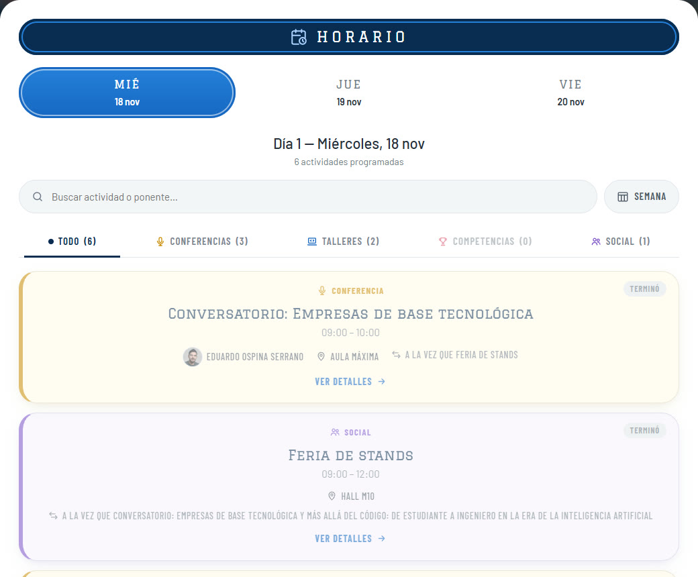
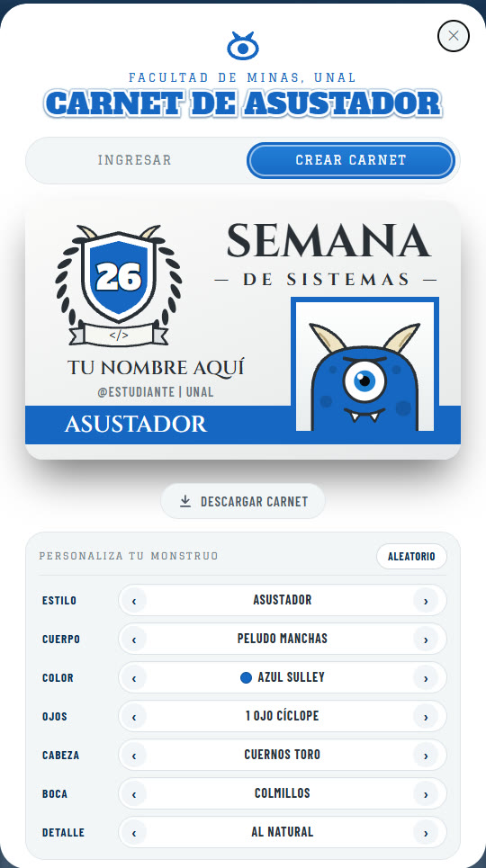
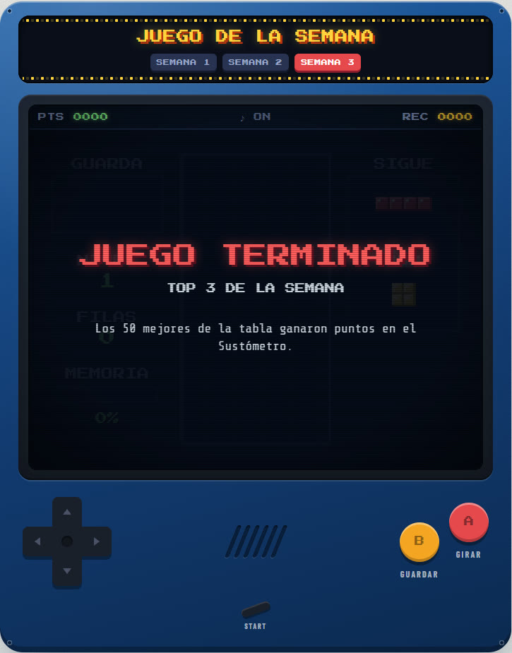
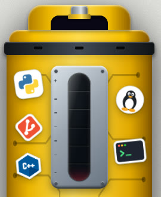
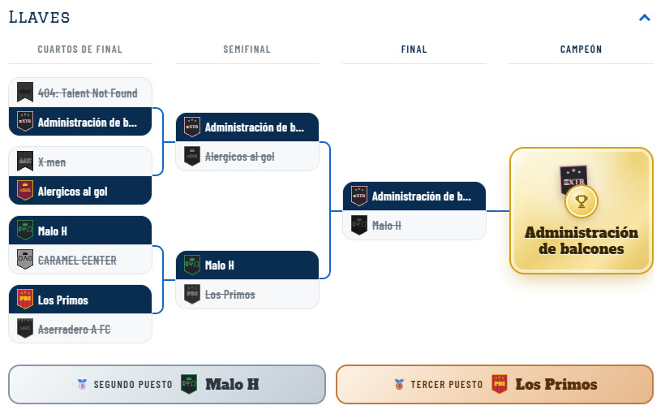
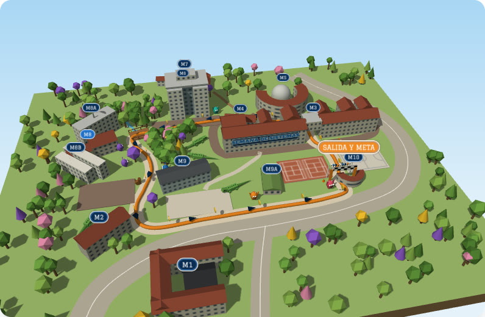
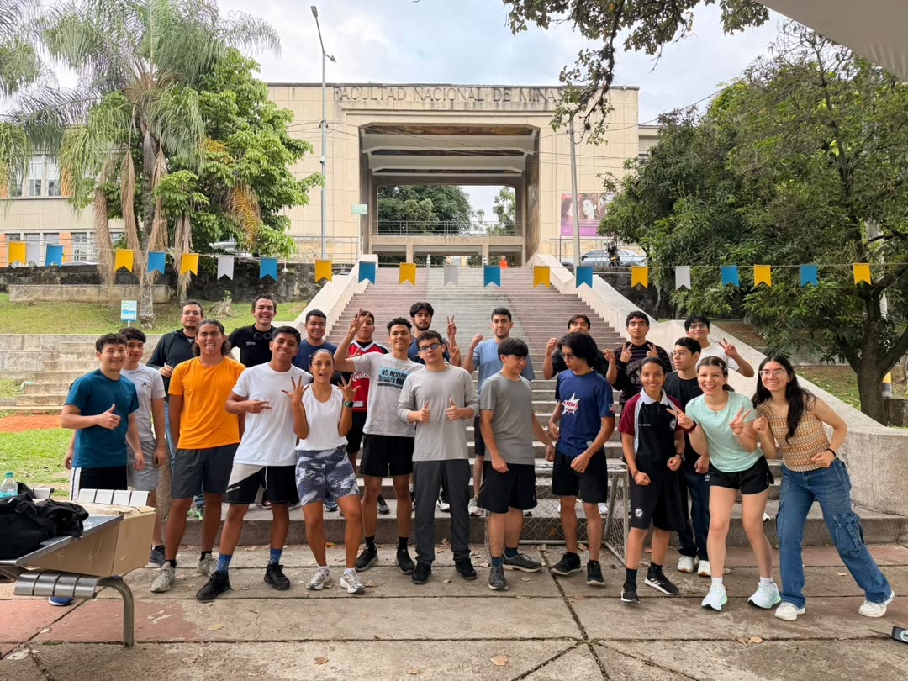

<div align="center">

<a href="https://semanasistemas.vercel.app" target="_blank" rel="noopener noreferrer">
  
</a>

**Facultad de Minas, Universidad Nacional de Colombia, sede Medellín**
<br />
18, 19 y 20 de noviembre de 2026

[![Astro][astro-badge]][astro-url]
[![TypeScript][typescript-badge]][typescript-url]
[![Tailwind CSS][tailwind-badge]][tailwind-url]
[![Supabase][supabase-badge]][supabase-url]
[![Vercel][vercel-badge]][vercel-url]

</div>

<br />

## Resultados

<div align="center">

| **+600** | **+375** | **16** | **3** |
| :---: | :---: | :---: | :---: |
| inscritos a través de la web | participaciones, presenciales y virtuales | actividades | días de evento |

</div>

- Conferencias con profesionales de la industria tech: **Eduardo Ospina Serrano**, **Mariano Andrés Sosa Soto**, **Carlos Martinez** y **Daniel Arango Sohm**.
- Empresas invitadas: **Zentrack**, **Lovelytics LATAM**, **Tata Consultancy Services**, **Globant** y **Unergy**.
- Talleres de IA, una maratón de programación y torneos que unieron a los diferentes pregrados.
- Una web propia, de cero, con cuentas, ranking en vivo, juegos y torneos.

<br />

## Funcionalidades

<table>
  <tr>
    <td width="55%" align="center">
      
    </td>
    <td width="45%" valign="middle">
      <h3>Horario en vivo</h3>
      <ul>
        <li>Los tres días en pestañas, más una <b>vista de semana</b> completa.</li>
        <li><b>Buscador</b> por actividad o ponente y <b>filtros por tipo</b> con conteo.</li>
        <li>Marca lo que está <b>en curso</b>, lo que <b>terminó</b> y lo que pasa <b>a la vez</b>.</li>
        <li>Cada actividad tiene su propia página con todos los detalles.</li>
        <li>Calendario <code>.ics</code> para suscribirse desde Google Calendar o el celular.</li>
      </ul>
    </td>
  </tr>
  <tr>
    <td width="45%" valign="middle">
      <h3>Carnet de asustador</h3>
      <ul>
        <li>Cada persona arma su <b>monstruo</b>: estilo, cuerpo, color, ojos, cabeza, boca y detalle.</li>
        <li>Botón <b>aleatorio</b> y descarga del carnet como imagen.</li>
        <li><b>Títulos</b> que se desbloquean con códigos y con <b>retos secretos</b> de cupo limitado, como el código Konami.</li>
      </ul>
    </td>
    <td width="55%" align="center">
      
    </td>
  </tr>
  <tr>
    <td width="55%" align="center">
      
    </td>
    <td width="45%" valign="middle">
      <h3>Juego de la semana</h3>
      <ul>
        <li>Una consola retro con un cartucho por semana: <b>Snake</b>, <b>Doom</b> y <b>Defrag</b>.</li>
        <li>Doom corre en el navegador: el motor original en C, compilado a <b>WebAssembly</b>.</li>
        <li><b>Récords en tiempo real</b> y partidas diarias limitadas, validadas en Supabase.</li>
        <li>Los 50 mejores de cada semana ganaron puntos en el Sustómetro.</li>
      </ul>
    </td>
  </tr>
  <tr>
    <td width="45%" valign="middle">
      <h3>El Sustómetro</h3>
      <ul>
        <li>El <b>ranking</b> del evento: cada participación suma puntos y llena tu tanque.</li>
        <li>Pasados los 100 puntos, el tanque revienta.</li>
        <li>Búsqueda, paginación y <b>tu puesto</b> siempre a la vista.</li>
      </ul>
    </td>
    <td width="55%" align="center">
      
    </td>
  </tr>
  <tr>
    <td width="55%" align="center">
      
    </td>
    <td width="45%" valign="middle">
      <h3>Llaves de torneos</h3>
      <ul>
        <li><b>Brackets</b> de eliminación directa y <b>tablas de posiciones</b>.</li>
        <li>Los supervisores cargan resultados <b>en vivo</b> desde la misma página.</li>
        <li>El permiso lo revisa Supabase, no el navegador.</li>
      </ul>
    </td>
  </tr>
  <tr>
    <td width="45%" valign="middle">
      <h3>Mapa 3D del recorrido</h3>
      <ul>
        <li>La carrera de atletismo dibujada sobre el campus con <b>three.js</b>.</li>
        <li>Se gira, se acerca y el corredor da la vuelta completa.</li>
        <li>Solo se carga en la página que lo usa.</li>
      </ul>
    </td>
    <td width="55%" align="center">
      
    </td>
  </tr>
</table>

### Y además

<table>
  <tr>
    <td width="33%" valign="top"><b>Inscripciones</b><br />Pre-inscripción a conferencias con cupos por sala, equipos con bandera propia y una lista para buscar equipo.</td>
    <td width="33%" valign="top"><b>Secretos</b><br />Easter eggs escondidos en la web: solo los primeros en encontrarlos ganan su título.</td>
    <td width="33%" valign="top"><b>Modo descanso</b><br />De 1 a 7 a. m. la web se va a dormir y manda a todos a recargar energía.</td>
  </tr>
  <tr>
    <td width="33%" valign="top"><b>Galería</b><br />Las fotos del evento, organizadas por edición.</td>
    <td width="33%" valign="top"><b>Cuentas</b><br />Registro e inicio de sesión con Supabase; las reglas importantes viven en políticas y funciones SQL.</td>
    <td width="33%" valign="top"><b>Hecha para el celular</b><br />Donde la gente la abrió durante el evento.</td>
  </tr>
</table>

<br />

## Configuración

Necesitas [Node.js](https://nodejs.org) 22 o superior y [pnpm](https://pnpm.io).

```sh
git clone https://github.com/JeroHoyos/semana_sistemas.git
cd semana_sistemas
pnpm install
pnpm dev
```

Abre `http://localhost:4321` y listo.

> La web local usa el mismo Supabase de producción: lo que hagas ahí queda guardado de verdad.

<details>
<summary>Más comandos y estructura</summary>

| Comando | Acción |
| :------ | :----- |
| `pnpm build` | Build de producción en `./dist/` |
| `pnpm preview` | Previsualiza el build |
| `pnpm check` | Revisa los tipos |
| `pnpm test` | Corre las pruebas (Vitest) |
| `pnpm lint` | Revisa el código con ESLint |

```text
src/
├── pages/     # index, evento, sustometro, inscripciones… y el calendario .ics
├── scripts/   # la lógica de cada página
├── games/     # la consola y sus juegos
├── lib/       # Supabase, sesión, utilidades, íconos
├── data/      # todo el contenido del evento
└── styles/    # estilos con los tokens de Tailwind
supabase/      # SQL de tablas, funciones y políticas
doom/          # el motor de Doom para la web
```

</details>

<br />

## Equipo

Web hecha por **Santiago Escobar Arias** y **Jerónimo Hoyos Botero**.

Organización: Jerónimo Hoyos Botero, Catalina Arango Sierra, Libardo Jose Navarro Pedrozo, Luzarait Canas Quintero y Juan David Pérez López.

Gracias al decano **Santiago Arango-Aramburo** por su compromiso con el desarrollo integral y profesional de los estudiantes de la Facultad de Minas, y a cada persona que se inscribió, se retó, aprendió y se quedó hasta el final.

<div align="center">
  <br />
  
  <br /><br />
  <sub>En la Facultad de Minas seguimos construyendo.</sub>
</div>

[astro-url]: https://astro.build/
[typescript-url]: https://www.typescriptlang.org/
[tailwind-url]: https://tailwindcss.com/
[supabase-url]: https://supabase.com/
[vercel-url]: https://vercel.com/
[astro-badge]: https://img.shields.io/badge/Astro-fff?style=for-the-badge&logo=astro&logoColor=bd303a&color=352563
[typescript-badge]: https://img.shields.io/badge/Typescript-007ACC?style=for-the-badge&logo=typescript&logoColor=white&color=blue
[tailwind-badge]: https://img.shields.io/badge/Tailwind-ffffff?style=for-the-badge&logo=tailwindcss&logoColor=38bdf8
[supabase-badge]: https://img.shields.io/badge/Supabase-1c1c1c?style=for-the-badge&logo=supabase&logoColor=3ecf8e
[vercel-badge]: https://img.shields.io/badge/Vercel-000000?style=for-the-badge&logo=vercel&logoColor=white
